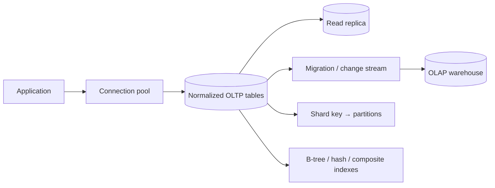

# Module 6 — Database Design & Storage

A source-linked, runnable Java 21 learning module. Each roadmap topic has its own directory with a guide, standalone example, and focused JUnit tests. Examples are local simulations—no broker, database, cloud account, or credential is required.

## Roadmap coverage map

| Roadmap topic | Explicit subtopics | Topic folder | Guide | Runnable example | Tests |
|---|---|---|---|---|---|
| Relational Databases (SQL) | Normalization; Indexing; Joins | [`topics/relational-sql/`](topics/relational-sql/) | [guide](topics/relational-sql/README.md) | [example](topics/relational-sql/src/main/java/Example.java) | [tests](topics/relational-sql/src/test/java/ExampleTest.java) |
| NoSQL Databases | Document; Key-Value; Column-Family; Graph | [`topics/nosql/`](topics/nosql/) | [guide](topics/nosql/README.md) | [example](topics/nosql/src/main/java/Example.java) | [tests](topics/nosql/src/test/java/ExampleTest.java) |
| Database Sharding | Horizontal Partitioning | [`topics/sharding/`](topics/sharding/) | [guide](topics/sharding/README.md) | [example](topics/sharding/src/main/java/Example.java) | [tests](topics/sharding/src/test/java/ExampleTest.java) |
| Database Replication | Master-Slave; Master-Master | [`topics/replication/`](topics/replication/) | [guide](topics/replication/README.md) | [example](topics/replication/src/main/java/Example.java) | [tests](topics/replication/src/test/java/ExampleTest.java) |
| Database Indexing | B-Tree; Hash; Composite | [`topics/indexing/`](topics/indexing/) | [guide](topics/indexing/README.md) | [example](topics/indexing/src/main/java/Example.java) | [tests](topics/indexing/src/test/java/ExampleTest.java) |
| CAP Theorem & PACELC | CAP Theorem; PACELC | [`topics/cap-pacelc/`](topics/cap-pacelc/) | [guide](topics/cap-pacelc/README.md) | [example](topics/cap-pacelc/src/main/java/Example.java) | [tests](topics/cap-pacelc/src/test/java/ExampleTest.java) |
| ACID vs BASE | ACID; BASE | [`topics/acid-base/`](topics/acid-base/) | [guide](topics/acid-base/README.md) | [example](topics/acid-base/src/main/java/Example.java) | [tests](topics/acid-base/src/test/java/ExampleTest.java) |
| Connection Pooling | Connection Pooling | [`topics/connection-pooling/`](topics/connection-pooling/) | [guide](topics/connection-pooling/README.md) | [example](topics/connection-pooling/src/main/java/Example.java) | [tests](topics/connection-pooling/src/test/java/ExampleTest.java) |
| Data Warehousing & OLAP vs OLTP | Data Warehousing; OLAP; OLTP | [`topics/data-warehousing/`](topics/data-warehousing/) | [guide](topics/data-warehousing/README.md) | [example](topics/data-warehousing/src/main/java/Example.java) | [tests](topics/data-warehousing/src/test/java/ExampleTest.java) |
| Time-Series Databases | Time-Series Databases | [`topics/time-series/`](topics/time-series/) | [guide](topics/time-series/README.md) | [example](topics/time-series/src/main/java/Example.java) | [tests](topics/time-series/src/test/java/ExampleTest.java) |
| Database Migration Strategies | Database Migration Strategies | [`topics/migrations/`](topics/migrations/) | [guide](topics/migrations/README.md) | [example](topics/migrations/src/main/java/Example.java) | [tests](topics/migrations/src/test/java/ExampleTest.java) |
## Architecture



The diagram is conceptual; every topic guide distinguishes the model from the limits of its in-memory example.

## Run and test

Requires a Java 21 toolchain (Gradle can use an installed JDK or a configured toolchain resolver).

```sh
./gradlew test
./gradlew runExample -Pexample=<fully-qualified-class-from-topic-guide>
./gradlew runAllExamples
```

Each topic guide provides its example’s exact fully qualified class name; package names are descriptive and need not mirror the directory name. Tests are intentionally offline apart from resolving the pinned JUnit dependency the first time Gradle runs.

## Trade-offs and anti-patterns

Prefer a well-normalized relational model until measured access patterns justify another model or partitioning. Choose consistency, key design, and operational limits explicitly; test migrations against mixed application versions.

- Avoid selecting a technology before identifying consistency, latency, durability, failure, and operational requirements.
- Avoid hiding stale reads, duplicate delivery, unbounded work, or schema changes behind a “best effort” abstraction.
- Examples are educational models, not production-ready clients or claims of vendor equivalence; follow the linked product documentation for configured guarantees.

## References

Topic guides link directly to primary vendor documentation and, where appropriate, a foundational paper/specification. Product behavior is version- and configuration-dependent; verify guarantees against the deployed version.
